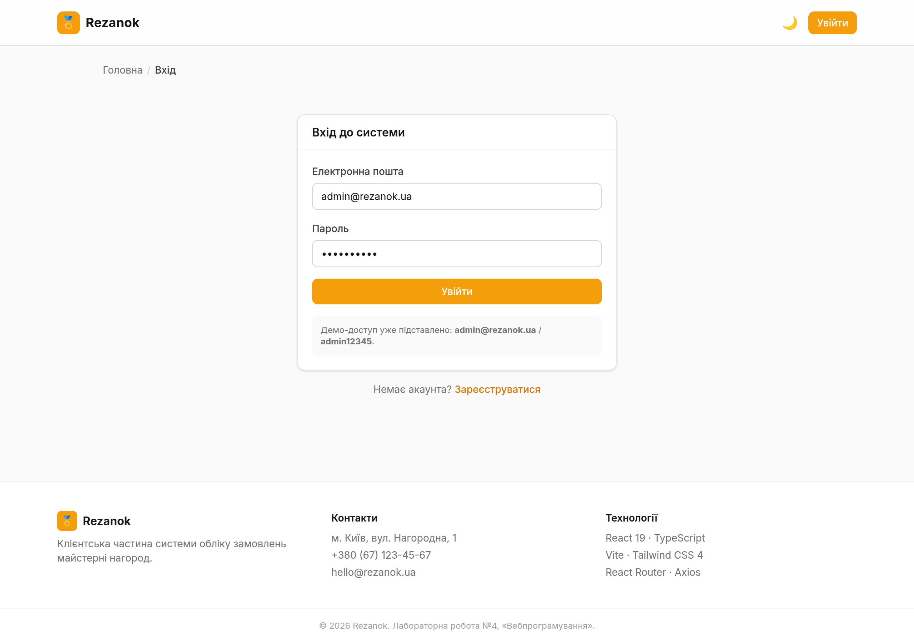
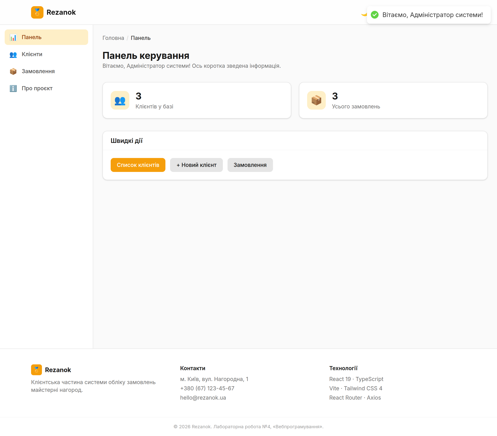
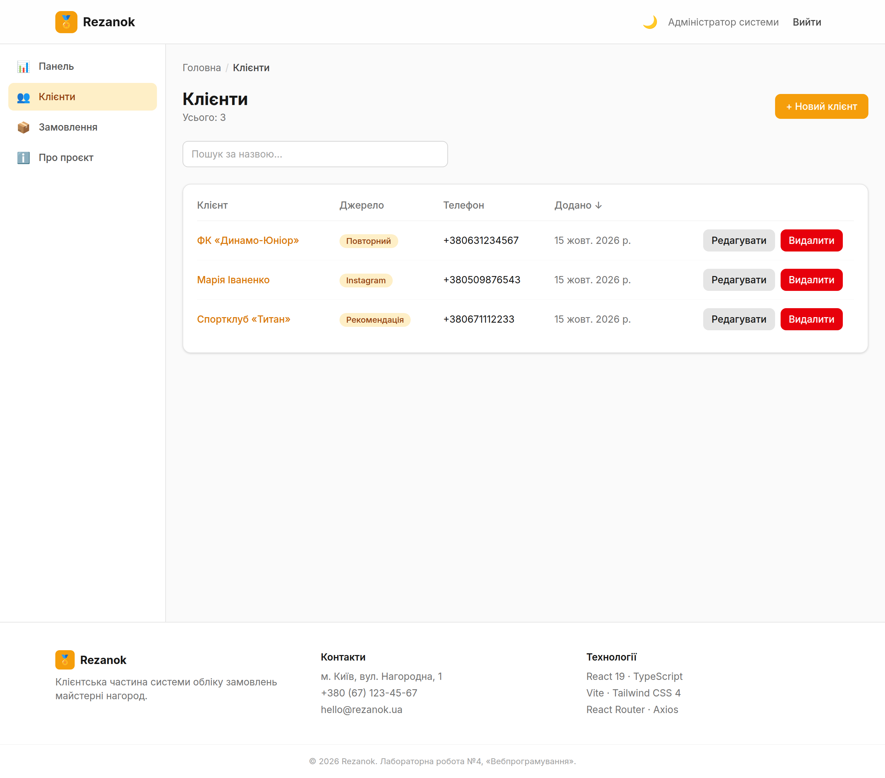
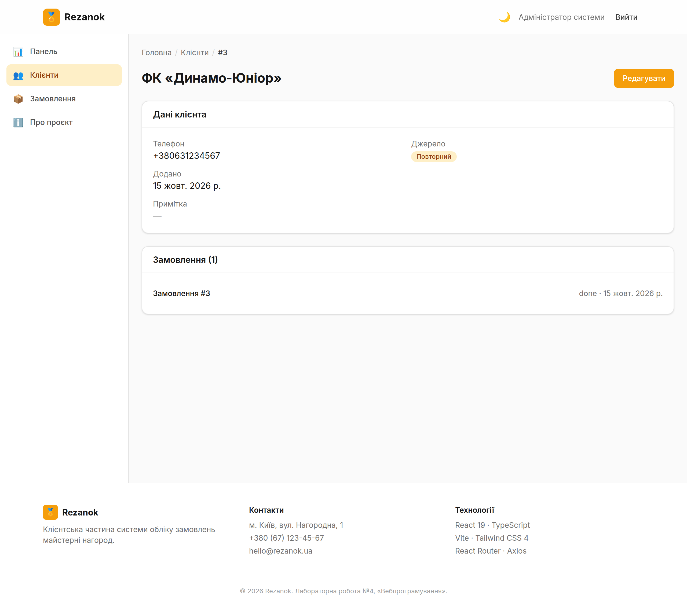
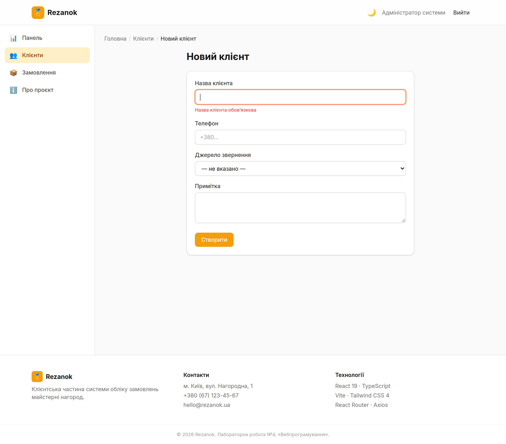
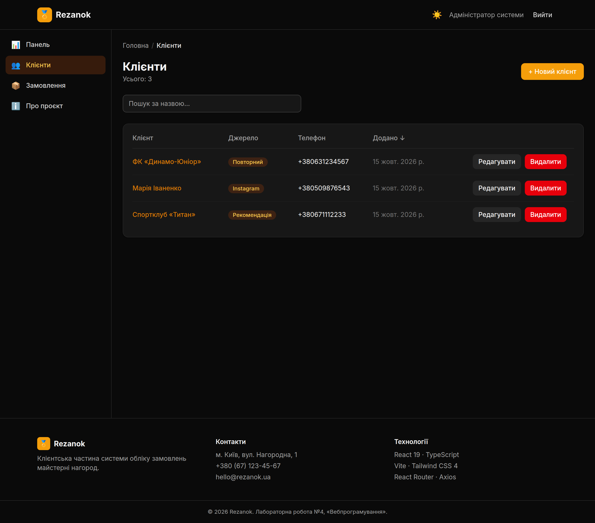
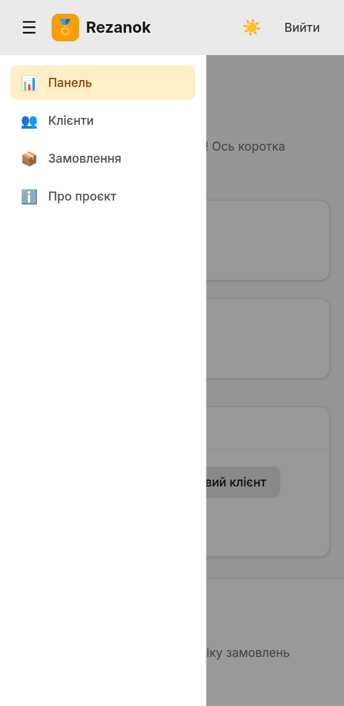

# Rezanok — основний інтерфейс клієнтської частини (React + TypeScript)

**Лабораторна робота №5 з дисципліни «Вебпрограмування»**
Виконала: Ткачук Евеліна

Повнофункціональна клієнтська частина (SPA) системи обліку замовлень майстерні нагород **Rezanok**. Якщо попередня робота налаштувала каркас React-проєкту, то ця будує на ньому робочий застосунок: аутентифікацію з реєстрацією та захищеними маршрутами, панель керування, CRUD-інтерфейси з валідацією форм, централізоване керування станом і розширений UI/UX (пошук, сортування, пагінація, сповіщення, скелетони, адаптивна бічна панель). Застосунок працює з реальним REST API, розгорнутим у ЛР3.

🌐 **Бекенд, з яким працює застосунок:** https://rezanok-api.onrender.com
🔑 Демо-доступ: `admin@rezanok.ua` / `admin12345`

---

## 1. Мета та завдання роботи

Метою роботи є набуття практичних навичок створення повнофункціонального користувацького інтерфейсу із системою аутентифікації, керуванням станом, валідацією форм та реалізацією CRUD-операцій для взаємодії з серверною частиною. У межах роботи реалізовано всі три рівні завдань методички: базову аутентифікацію з панеллю керування, CRUD-інтерфейси з валідацією та розширений UI/UX із централізованим станом.

## 2. Технології

| Технологія          | Версія | Призначення                                               |
| ------------------- | ------ | --------------------------------------------------------- |
| React               | 19     | Бібліотека інтерфейсу (ref як проп, без forwardRef)       |
| TypeScript          | 6      | Статична типізація                                        |
| Vite                | 8      | Збірка та dev-сервер із HMR                               |
| Tailwind CSS        | 4      | Утилітарна стилізація (через плагін `@tailwindcss/vite`)  |
| React Router        | 8      | Клієнтська маршрутизація SPA                              |
| **Zustand**         | 5      | Клієнтський глобальний стан (аутентифікація) з `persist`  |
| **TanStack Query**  | 5      | Кешування серверних даних, мутації, інвалідація           |
| **React Hook Form** | 7      | Керування формами через реєстрацію полів                  |
| **Zod**             | 4      | Схеми валідації з виведенням типів                        |
| **React Hot Toast** | 2      | Спливні сповіщення про результат операцій                 |
| Axios               | 1.x    | HTTP-клієнт з interceptors                                |
| ESLint + Prettier   | 10 / 3 | Статичний аналіз та форматування                          |

Проєкт вимагає **Node.js 20.19+ або 24 LTS**.

## 3. Архітектура та структура

Код організовано за зонами відповідальності з абсолютними імпортами через префікс `@/` (аліас на `src/`). Порівняно з попередньою роботою з'явилися окремі папки для глобального стану (`store/`), схем валідації (`schemas/`), доменних сервісів (`services/`) та бібліотечної конфігурації (`lib/`).

```
webprog-lab-05/
├── src/
│   ├── components/
│   │   ├── common/        Button, Input, Card, Badge, Loading,
│   │   │                  Table, Skeleton, FormField, ConfirmDialog
│   │   ├── layout/        Header, Sidebar, Breadcrumbs, Footer, Layout
│   │   ├── ClientForm.tsx      спільна форма створення/редагування
│   │   ├── ErrorBoundary.tsx   межа помилок (класовий компонент)
│   │   └── ProtectedRoute.tsx  захист маршрутів від неавторизованих
│   ├── pages/             Home, Login, Register, Dashboard, About,
│   │                      ClientsList, ClientCreate, ClientDetail,
│   │                      ClientEdit, Orders, NotFound
│   ├── store/             authStore.ts — Zustand + persist
│   ├── lib/               queryClient.ts — конфігурація TanStack Query
│   ├── services/          api.ts (axios + interceptors), auth, clients, rezanok
│   ├── schemas/           auth.schema.ts, client.schema.ts — Zod-схеми
│   ├── hooks/             useTheme, useDebounce
│   ├── types/             api.types.ts — типи відповідей API
│   ├── utils/             format.ts (дати/валюта), cn.ts (класи)
│   ├── constants/         адреси, навігація, ключі сховища
│   ├── App.tsx            маршрутизація
│   └── main.tsx           точка входу (ErrorBoundary + QueryClientProvider + Toaster)
├── .env / .env.example    VITE_API_URL, VITE_APP_NAME
├── eslint.config.js       плоский конфіг ESLint
├── vite.config.ts         плагіни React + Tailwind, аліас @/
└── tailwind — через @theme у src/index.css
```

## 4. Рівень 1 — аутентифікація та панель керування

Реалізовано повний потік аутентифікації. Сторінки **входу** (`/login`) та **реєстрації** (`/register`) мають форми з валідацією; після входу застосунок звертається до `/auth/login`, зберігає профіль і access-токен та перенаправляє на панель керування. Стан аутентифікації тримає **Zustand**-сховище (`store/authStore.ts`) з middleware `persist`, тож сесія переживає перезавантаження сторінки без окремого запиту на відновлення. Вихід (`logout`) очищає сховище й повертає гостьовий інтерфейс.

Захист маршрутів реалізовано компонентом `ProtectedRoute`: неавторизованого користувача він перенаправляє на `/login`. Головна **панель керування** (`/dashboard`) показує зведені показники й навігацію до розділів. Протягом усіх запитів працюють індикатори завантаження, а помилки рендерингу перехоплює класовий `ErrorBoundary`.

## 5. Рівень 2 — CRUD-інтерфейси та валідація

На прикладі сутності **«Клієнти»** побудовано повний CRUD-цикл: список (`/clients`), створення (`/clients/new`), детальний перегляд (`/clients/:id`) та редагування (`/clients/:id/edit`). Створення й редагування використовують спільний компонент `ClientForm`, а видалення відбувається через модальне вікно підтвердження `ConfirmDialog`.

Форми керуються **React Hook Form**, а правила опису винесено у **Zod**-схеми (`schemas/`), звідки ж виводяться й типи даних — одне джерело істини для валідації та TypeScript. Помилки полів показує перевикористовний `FormField`. Список побудовано на перевикористовному компоненті `Table` з типізованими колонками й **пагінацією** (по 8 записів на сторінку).

## 6. Рівень 3 — розширений стан та UI/UX

Керування даними поділено за призначенням: клієнтський стан (сесія) живе у Zustand, а серверні дані кешує **TanStack Query**. Списки й деталі завантажуються через `useQuery`, а зміни (створення, редагування, видалення) — через `useMutation` з автоматичною **інвалідацією кешу**, тож інтерфейс завжди показує актуальні дані. Параметр `keepPreviousData` прибирає миготіння під час перегортання сторінок.

Про результат кожної операції повідомляє **toast** (React Hot Toast). Список клієнтів має **пошук** за назвою з `debounce` (400 мс, хук `useDebounce`), **сортування** за клацанням на заголовку колонки (з перемиканням напрямку) та **пагінацію**. Поки дані вантажаться, замість порожнечі показуються **скелетони** (`Skeleton`). Навігацію доповнюють **хлібні крихти** (`Breadcrumbs`) та **адаптивна бічна панель** (`Sidebar`), що згортається на мобільних екранах. Збережено світлу й темну теми з ручним перемиканням (хук `useTheme`, вибір у `localStorage`).

## 7. Робота з API

Усі запити йдуть через єдиний екземпляр Axios (`services/api.ts`) з базовою адресою зі змінної `VITE_API_URL`. Налаштовано два **interceptors**: запит автоматично отримує заголовок `Authorization: Bearer <token>` зі сховища Zustand, а відповідь із кодом **401** централізовано очищає сесію й відправляє користувача на сторінку входу. Відповіді суворо типізовані (`types/api.types.ts`): узагальнені `ApiResponse<T>` і `PaginatedResponse<T>` з метаданими пагінації, структура помилки та доменні типи `User`, `Client`, `Order`. Доменні сервіси (`clients.service.ts`, `auth.service.ts`, `rezanok.service.ts`) інкапсулюють ендпоінти, а сторінки працюють уже з готовими функціями.

## 8. Запуск

```bash
# Потрібен Node.js 20.19+ (або 24 LTS)
npm install            # залежності
cp .env.example .env   # налаштування (за замовчуванням — розгорнутий бекенд)
npm run dev            # dev-сервер із HMR на http://localhost:5173
npm run build          # production-збірка (tsc + vite)
npm run lint           # перевірка ESLint
npm run format         # форматування Prettier
```

### Змінні середовища

| Змінна          | Призначення            | Приклад                                |
| --------------- | ---------------------- | -------------------------------------- |
| `VITE_API_URL`  | Базова адреса REST API | `https://rezanok-api.onrender.com/api` |
| `VITE_APP_NAME` | Назва застосунку       | `Rezanok`                              |

## 9. Демонстрація роботи

**Сторінка входу** — форма з валідацією полів та станом завантаження; демо-доступ підставлено.



**Панель керування** — зведені показники та навігація до розділів після успішного входу.



**Список клієнтів** — таблиця з пошуком, сортуванням за заголовками, пагінацією та діями (перегляд, редагування, видалення).



**Детальна сторінка клієнта** — повні дані запису разом із пов'язаними замовленнями.



**Створення клієнта — валідація форми** — повідомлення про помилки з Zod-схеми у React Hook Form.



**Список клієнтів (темна тема)** — той самий розділ після перемикання теми.



**Мобільний вигляд — бічна панель** — адаптивний `Sidebar`, що згортається на вузькому екрані.



## 10. Висновки

У результаті роботи створено повнофункціональну клієнтську частину системи обліку замовлень майстерні нагород, яка реалізує всі три рівні завдань методички. Побудовано систему аутентифікації з реєстрацією, захищеними маршрутами та збереженням сесії; CRUD-інтерфейси для сутності клієнтів зі створенням, переглядом, редагуванням і видаленням; валідацію форм на React Hook Form і Zod зі спільними типами. Керування станом поділено між Zustand (клієнтський стан) і TanStack Query (серверні дані з кешуванням та інвалідацією), а взаємодію з користувачем доповнено toast-сповіщеннями, пошуком, сортуванням, пагінацією, скелетними індикаторами, хлібними крихтами та адаптивною бічною панеллю. Застосунок підключено до реального розгорнутого бекенду з попередніх робіт, що демонструє завершений цикл «клієнт — сервер — база даних».
</content>
</invoke>
